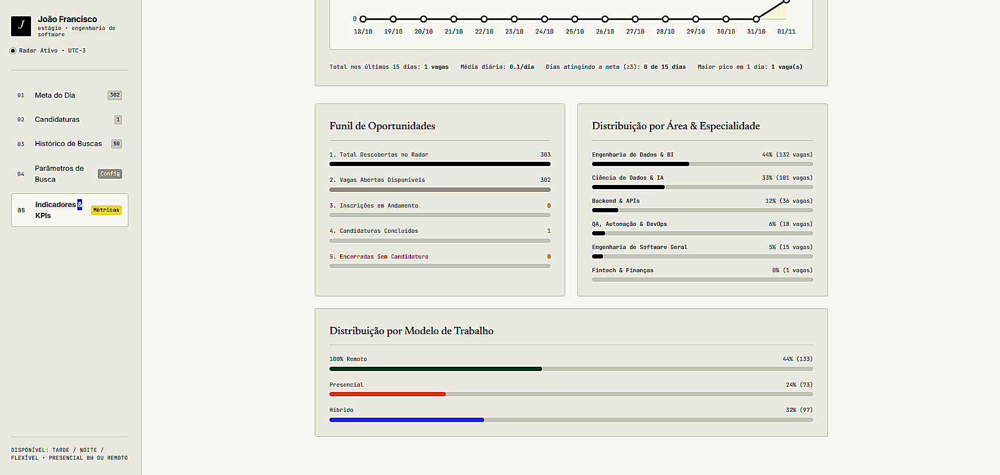

<div align="center">

# 🎯 Sona
### Autonomous Job Hunter & Application Tracker for Tech Internships

[](LICENSE)
[](https://nodejs.org)
[](#)
[](#)
[](#)

<!-- Resumo direto: 1 frase de impacto -->
**Varre plataformas de vagas em segundo plano, filtra oportunidades compatíveis com seu turno e gerencia o funil de candidaturas em um dashboard local zero-config.**

[Ver Dashboard](#-início-rápido-2-cliques) · [Configurar Parâmetros](#-filtros-determinísticos) · [Suíte de Testes](#-suíte-de-testes)

<br/>

<!-- HERO VISUAL: Imagem em assets/dashboard_preview.png -->


</div>

---

### 💡 Por que o Sona?

Buscar estágio manualmente em dezenas de sites consome horas e gera candidaturas desorganizadas. O Sona automatiza o ciclo completo:

- **Busca Determinística & Anti-Duplicatas:** Varre Gupy, LinkedIn e portais oficiais, filtrando apenas vagas que batem com seu curso, turno e cidades de interesse.
- **Zero Configuração de Servidor:** O dashboard roda 100% offline direto no navegador com persistência em JSON — sem precisar de Docker, banco externo ou conta na nuvem.
- **Foco em Execução (Meta de 3 Vagas/Dia):** Funil Kanban (Em Andamento → Aplicadas → Salvas), cronômetro por inscrição e telemetria de taxa de conversão.

---

### 🚀 Início Rápido (2 Cliques)

#### 1. Acessar o Dashboard
Dê dois cliques em **`dashboard.html`** (ou `index.html`) no navegador. O painel carrega instantaneamente sem necessidade de `npm start`.

#### 2. Executar Varredura Manual
Para buscar novas vagas agora mesmo via terminal:
```powershell
powershell -ExecutionPolicy Bypass -File .\executar_busca.ps1
```

#### 3. Ativar em Segundo Plano (Piloto Automático)
Para agendar varreduras de hora em hora pelo Agendador de Tarefas do Windows:
```powershell
powershell -ExecutionPolicy Bypass -File .\agendar_tarefas.ps1
```

---

### ⚙️ Filtros Determinísticos

Ajuste os critérios pela aba **`04 / Parâmetros`** do dashboard ou direto no `config_busca.json`:

```json
{
  "candidato": "João Francisco",
  "periodo": "Engenharia de Software",
  "turnoFaculdade": "Manhã",
  "turnosDisponiveis": ["Tarde (12h-18h)", "Flexível"],
  "estado": "MG",
  "cidades": ["Belo Horizonte", "Contagem", "Nova Lima"],
  "aceitaRemoto": true,
  "areasInteresse": "Engenharia de Software, Backend, Dados, IA"
}
```

---

### 🧰 Stack Tecnológica

| Camada | Tecnologia | Motivo da Decisão |
| :--- | :--- | :--- |
| **Interface (Dashboard)** | Vanilla JS + Tailwind CSS | Estética editorial *Paper & Ink*, zero tempo de build e execução offline instantânea. |
| **Engine de Varredura** | Node.js + PowerShell | Orquestração nativa no Windows, parse determinístico e integração com Task Scheduler. |
| **Armazenamento** | JSON Local + Bridges JS | Base de dados portátil, versionável no Git e sem dependência de serviços externos. |

---

### 🧪 Suíte de Testes

```bash
npm test
```
> Valida integridade do funil de candidaturas, persistência dos dados e precisão dos indicadores.

---

<div align="center">
  <sub>Criado por <strong><a href="https://github.com/joaofr-tech">João Francisco</a></strong> · Licença MIT.</sub>
</div>
