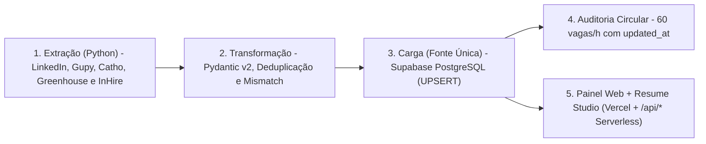

<div align="center">

# Sona
### Pipeline ETL de Vagas, Rastreador de Candidaturas & Estúdio de Currículo ATS Anti-Alucinação

[](LICENSE)
[](https://www.python.org)
[](https://nodejs.org)
[](https://docs.pydantic.dev)
[](https://supabase.com)
[](vercel.json)
[](DESIGN.md)

**Plataforma completa para busca de estágios em TI: pipeline ETL concorrente em Python com Supabase como Fonte Única da Verdade, painel analítico Obsidian Dark e Sona Resume Studio (gerador de currículos ATS em 3 camadas anti-alucinação com BYOK).**

[Arquitetura](#-arquitetura) · [Sona Resume Studio](#-sona-resume-studio-ats-anti-alucinação) · [Início Rápido](#-início-rápido) · [Deploy na Vercel](#-deploy-na-vercel--supabase) · [Suíte de Testes](#-suíte-de-testes)

<br/>


</div>

---

### Por que o Sona?

- **Ingestão Concorrente Multi-Fonte:** Extratores paralelos em Python (`httpx` + `ThreadPoolExecutor`) coletam vagas em **LinkedIn, Gupy, Catho, Greenhouse e InHire** com retentativas e backoff exponencial.
- **Qualidade de Dados & Deduplicação Determinística:** Contratos estritos em **Pydantic v2** validam URLs (incluindo bloqueio de links temporários `grounding-api-redirect`), enquanto a normalização canônica (`empresa::cargo` + link) e as regras de *mismatch* filtram ruídos antes da carga.
- **Nuvem como Fonte Única da Verdade + Auditoria Circular:** O **PostgreSQL no Supabase** centraliza vagas via `UPSERT` idempotente, com auditoria circular de vagas encerradas (60 vagas/hora por `updated_at`) e modo `--require-cloud` (fail-fast) no GitHub Actions.
- **Sona Resume Studio (ATS Anti-Alucinação):** Gera currículos sob medida por vaga usando sua própria chave de IA (**BYOK**: Gemini, OpenAI, Groq ou OpenRouter) a partir de um **Banco de Fatos** verificado (GitHub Sync, LinkedIn `.zip`/PDF e Currículo Base).
- **Design System Obsidian Dark:** Interface unificada em [DESIGN.md](DESIGN.md) e [design-system.css](design-system.css) com Meta do Dia, Catálogo de Vagas, Insights analíticos e Estúdio de Currículo embutido.

---

### Arquitetura



```text
├── etl/                        # Pipeline ETL Python (Pydantic v2, Supabase, Auditoria, Notificador)
│   └── extractors/             # Conectores paralelos (LinkedIn, Gupy, Catho, Greenhouse/InHire)
├── api/                        # Vercel Serverless Functions do Sona Resume Studio & Conta
│   ├── account.js              # DELETE /api/account (Exclusão autenticada da conta via Admin API)
│   ├── generate-resume.js      # POST /api/generate-resume (Pipeline ATS em 3 camadas)
│   ├── github-sync.js          # POST /api/github-sync (Seletor inteligente + leitura de READMEs)
│   ├── parse-resume-pdf.js     # POST /api/parse-resume-pdf (Extração factual de PDF)
│   └── _lib/                   # Motor anti-alucinação (resume_engine.js), BYOK (llm.js), parser LinkedIn
├── auth.html / .css / auth_guard.js # Autenticação obrigatória (Login, Cadastro, Recuperação e OAuth)
├── dashboard.html / index.html # Painel principal (Obsidian Dark) sincronizado com Supabase
├── curriculo.html / .js / .css # Sona Resume Studio (Editor WYSIWYG, Onboarding, Banco de Fatos)
├── design-system.css           # Tokens e componentes do Design System (DESIGN.md)
├── schema_supabase.sql         # Schema + RLS de `vagas` e `historico_execucoes`
├── schema_curriculo_supabase.sql # Schema + RLS de `master_profiles` e `curriculos_gerados`
├── schema_auth_supabase.sql    # Schema + RLS de `user_settings`, `user_vagas` e trigger `on_auth_user_created`
├── tests/                      # Testes Node.js (Dashboard, Motor ATS, APIs e Segurança Local)
├── tests_py/                   # Testes Python (ETL unitários + E2E Playwright)
└── .github/workflows/          # CI em PRs (ci.yml) + ETL horário fail-fast (etl_pipeline.yml)
```

---

### Sona Resume Studio (ATS Anti-Alucinação)

O módulo de currículos em [curriculo.html](curriculo.html) segue um pipeline em **3 camadas** ([api/_lib/resume_engine.js](api/_lib/resume_engine.js)):
1. **Camada 1 — Matriz de Aderência & Seleção Determinística:** Analisa a vaga (detectando PT-BR ou EN), seleciona deterministicamente os Top 2–3 projetos reais mais relevantes e separa *direct matches*, equivalências honestas e *excluded gaps*.
2. **Camada 2 — Geração Isolada por Entidade:** Cada projeto e experiência é reescrito em chamada isolada contendo apenas seus próprios fatos verificados (impossibilitando contaminação cruzada), enquanto formação acadêmica e dados básicos são copiados de forma 100% determinística.
3. **Camada 3 — Guardrails em Código + Auditor Semântico (Critic):** Filtra tecnologias contra a *whitelist* verificada, bloqueia termos de *excluded gaps* e audita cada bullet contra sua evidência original.

---

### Início Rápido

#### 1. Instalar Dependências & Configurar `.env`
```bash
npm install
pip install -r requirements.txt
```
Copie [.env.example](.env.example) para `.env` e preencha:
- **Obrigatórios para nuvem:** `SUPABASE_URL`, `SUPABASE_ANON_KEY`, `SUPABASE_SERVICE_ROLE_KEY`
- **Opcionais:** `EMAIL_ADDRESS`, `EMAIL_PASSWORD`, `ALERT_WEBHOOK_URL`

#### 2. Provisionar o Banco no Supabase
No **SQL Editor** do Supabase, execute os três scripts idempotentes em ordem:
1. [schema_supabase.sql](schema_supabase.sql) — tabelas `vagas` (com `updated_at`) e `historico_execucoes`, com escrita restrita à `service_role`.
2. [schema_curriculo_supabase.sql](schema_curriculo_supabase.sql) — tabelas `master_profiles` e `curriculos_gerados` com RLS estrita por `auth.uid()`.
3. [schema_auth_supabase.sql](schema_auth_supabase.sql) — tabelas `user_settings` e `user_vagas`, trigger automático `on_auth_user_created` e políticas RLS fechadas para usuários autenticados.

> **Configuração do Supabase Auth:** No painel do Supabase, acesse **Authentication -> URL Configuration** e defina a `Site URL` (ex.: `http://127.0.0.1:3000` localmente ou o domínio de produção na Vercel) e adicione em **Redirect URLs** `http://127.0.0.1:3000/**` e `https://<seu-dominio>.vercel.app/**`. Opcionalmente, habilite o provedor **GitHub** em **Authentication -> Providers** para login via OAuth.

#### 3. Executar Pipeline ETL Manualmente
```bash
# Execução local (usa Supabase se configurado ou fallback local)
python -m etl.pipeline

# Execução fail-fast exigindo conexão e persistência no Supabase (usado na CI)
python -m etl.pipeline --require-cloud

# Teste sem rede e sem escrita no banco
python -m etl.pipeline --skip-network --dry-run
```

> **Nota sobre telemetria:** Na nuvem (`historico_execucoes` do Supabase), o ETL registra o resumo por execução (`timestamp`, `status`, `is_erro`, `duracao_segundos`, `mensagem`, `total_vagas`). O detalhamento granular por fonte (`fontes`, `funil`, `auditoria`) é gravado no cache local `historico_execucoes.js`.

#### 4. Rodar o Painel + APIs Localmente
```bash
npm start
```
Acesse `http://127.0.0.1:3000`. O servidor local [servidor.js](servidor.js) escuta apenas em `127.0.0.1` por padrão (use `HOST=0.0.0.0 npm start` apenas se quiser expor na rede local), bloqueia dotfiles/arquivos sensíveis e roteia `/api/*` para as funções em `api/`.

---

### Deploy na Vercel & GitHub Actions

- **Vercel ([vercel.json](vercel.json)):**
  - `buildCommand`: `npm run build` (copia os artefatos estáticos para `public/` via [scripts/build_dashboard.js](scripts/build_dashboard.js)).
  - `outputDirectory`: `public`.
  - Funções serverless: `/api/generate-resume` (`maxDuration: 60`), `/api/github-sync` (`30s`), `/api/parse-resume-pdf` (`30s`) e `/api/account` (`15s`, requer `SUPABASE_URL` e `SUPABASE_SERVICE_ROLE_KEY` nas variáveis de ambiente da Vercel para exclusão de conta).
  - **Importante:** Não use GitHub Pages para produção — o Resume Studio requer o runtime serverless `/api/*` da Vercel.
- **GitHub Actions:**
  - [`.github/workflows/etl_pipeline.yml`](.github/workflows/etl_pipeline.yml): executa `pytest` + `python -m etl.pipeline --require-cloud` a cada hora. Exige os secrets `SUPABASE_URL` e `SUPABASE_SERVICE_ROLE_KEY` (e opcionalmente `EMAIL_ADDRESS`, `EMAIL_PASSWORD`, `ALERT_WEBHOOK_URL`).
  - [`.github/workflows/ci.yml`](.github/workflows/ci.yml): executa `npm test`, `pytest tests_py/test_etl_pipeline.py -v` e verifica a sincronia de `npm run build` (`public/`) em todo `push` e `pull_request` para `main`.

---

### Filtros Determinísticos

Ajuste os critérios pela aba **`Parâmetros do Crawler`** do painel ou diretamente em [config_busca.json](config_busca.json).

---

### Suíte de Testes

```bash
# Testes Node.js (Candidaturas, Indicadores, Parâmetros, ETL/Observabilidade, Motor ATS, APIs e Segurança Local)
npm test

# Testes unitários do Pipeline ETL Python (Pydantic, Transformação, Fail-Fast Cloud, Extratores e Logs)
pytest tests_py/test_etl_pipeline.py -v

# Teste E2E completo no navegador (requer Playwright instalado: pip install playwright)
npm run test:e2e
```

---

<div align="center">
  <sub>Criado por <strong><a href="https://github.com/joaofr-tech">João Francisco</a></strong> · Licença MIT.</sub>
</div>
