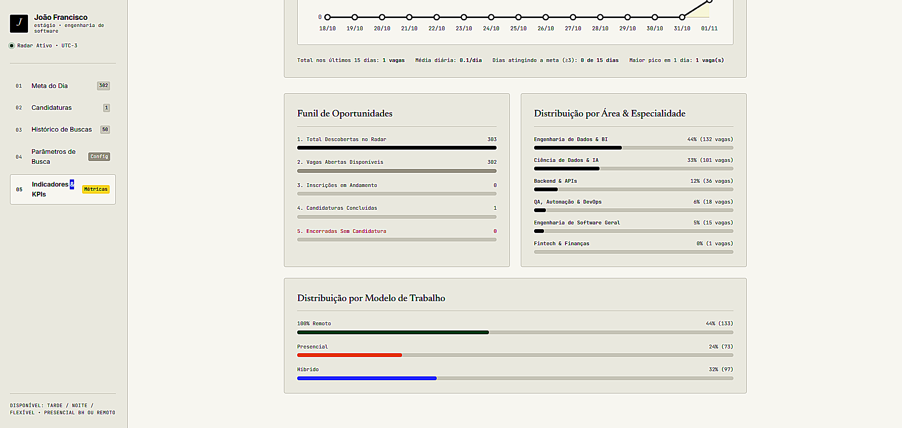
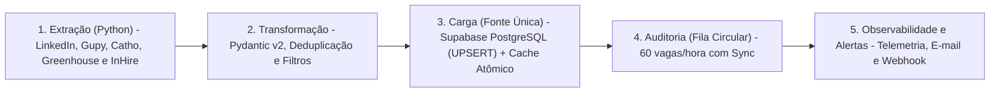

<div align="center">

# 🎯 Sona
### Pipeline ETL de Engenharia de Dados & Rastreador de Candidaturas para Estágios em TI

[](LICENSE)
[](https://www.python.org)
[](https://docs.pydantic.dev)
[](https://supabase.com)
[](.github/workflows/etl_pipeline.yml)
[](#)
[](#)

<!-- Resumo direto: 1 frase de impacto -->
**Pipeline ETL focado em nuvem em Python com validação Pydantic v2, carga idempotente no Supabase (PostgreSQL), auditoria em fila circular e observabilidade por fonte.**

[Arquitetura ETL](#-arquitetura-do-pipeline-etl) · [Início Rápido](#-início-rápido) · [Configurar Parâmetros](#-filtros-determinísticos) · [Suíte de Testes](#-suíte-de-testes)

<br/>

<!-- HERO VISUAL: Imagem em assets/dashboard_preview.png -->


</div>

---

### 💡 Por que o Sona?

Buscar estágio manualmente em dezenas de sites consome horas e gera candidaturas desorganizadas. O Sona automatiza o ciclo completo com práticas de Engenharia de Dados:

- **Ingestão Concorrente Multi-Fonte:** Extratores paralelos em Python (`httpx` + `ThreadPoolExecutor`) coletam vagas em **LinkedIn, Gupy, Catho, Greenhouse e InHire** com retentativas e espera exponencial.
- **Qualidade de Dados & Deduplicação Determinística:** Contratos estritos em **Pydantic v2** validam URLs e campos obrigatórios, enquanto a normalização canônica (`empresa::cargo` + link) e as regras de incompatibilidade (*mismatch*) filtram ruídos antes da carga.
- **Nuvem como Fonte Única da Verdade + Auditoria Circular:** O **PostgreSQL no Supabase** centraliza os dados via gravação idempotente (`UPSERT`), com auditoria de vagas encerradas em fila circular (rodízio contínuo por `updated_at`) e cópia local atômica para o painel.
- **Observabilidade Real:** Telemetria estruturada por fonte, funil e auditoria, com detector de fontes estagnadas (3 rodadas sem retorno), rotação automática de logs e alertas críticos via Webhook/e-mail.

---

### 🏗️ Arquitetura do Pipeline ETL



```text
├── etl/
│   ├── models.py               # Contratos Pydantic v2 (VagaRecord, PipelineRunTelemetry)
│   ├── repository.py           # Supabase PostgreSQL (Fonte Única) + escrita atômica local
│   ├── transform.py            # Normalização canônica, deduplicação e filtro de incompatibilidade
│   ├── auditor.py              # Auditoria em fila circular (rodízio contínuo)
│   ├── notifier.py             # Resumo por e-mail, rotação de logs e alertas críticos
│   ├── pipeline.py             # Orquestrador principal (`python -m etl.pipeline`)
│   └── extractors/             # Conectores paralelos (LinkedIn, Gupy, Catho, Greenhouse/InHire)
├── tests_py/                   # Suíte de testes unitários em pytest
├── .github/workflows/          # Agendamento horário automatizado na nuvem (GitHub Actions)
└── dashboard.html              # Painel visual (Paper & Ink) conectado ao Supabase
```

---

### 🚀 Início Rápido

#### 1. Instalar Dependências Python & Configurar `.env`
```bash
pip install -r requirements.txt
```
Configure no `.env` (ou nos segredos do **GitHub Actions**): `SUPABASE_URL`, `SUPABASE_SERVICE_ROLE_KEY`, e opcionalmente `EMAIL_ADDRESS`, `EMAIL_PASSWORD` e `ALERT_WEBHOOK_URL`.

#### 2. Executar Pipeline ETL Manualmente
```bash
python -m etl.pipeline
# ou via script do npm:
npm run etl
```
> Para testar o fluxo sem chamadas de rede nem escrita no banco: `python -m etl.pipeline --skip-network --dry-run`.

#### 3. Agendamento Automático (Nuvem ou Local)
* **Nuvem (GitHub Actions):** O fluxo [`.github/workflows/etl_pipeline.yml`](.github/workflows/etl_pipeline.yml) executa `pytest` + `python -m etl.pipeline` automaticamente a cada hora (`cron: '0 * * * *'`), gravando direto no Supabase.
* **Local (Agendador de Tarefas do Windows):** Para agendar execução horária local via [executar_busca.ps1](executar_busca.ps1):
  ```powershell
  powershell -ExecutionPolicy Bypass -File .\agendar_tarefas.ps1
  ```

#### 4. Acessar o Painel
Abra **`dashboard.html`** (ou `index.html`) diretamente no navegador ou via `npm start`. O painel sincroniza em tempo real com o Supabase e exibe o funil de candidaturas + aba **`03 / Histórico`** com métricas por fonte.

---

### ⚙️ Filtros Determinísticos

Ajuste os critérios pela aba **`04 / Parâmetros`** do painel ou direto no `config_busca.json`:

```json
{
  "candidato": "João Francisco",
  "periodo": "3º período de Engenharia de Software",
  "turnoFaculdade": "Manhã",
  "turnosDisponiveis": ["Tarde (12h-18h / 13h-19h)", "Noite", "Flexível (6h)"],
  "estado": "MG",
  "cidades": ["Belo Horizonte", "Contagem", "Betim", "Nova Lima", "Ibirité"],
  "aceitaPresencial": true,
  "aceitaHibrido": true,
  "aceitaRemoto": true,
  "areasInteresse": "Engenharia de Software, Desenvolvimento Web/Full Stack/Backend/Frontend, Engenharia/Ciência de Dados, IA e Automação"
}
```

---

### 🧰 Stack Tecnológica

| Camada | Tecnologia | Motivo da Decisão |
| :--- | :--- | :--- |
| **Pipeline ETL & Extração** | Python 3.12+ · `httpx` · `ThreadPoolExecutor` | Ingestão paralela com retentativas automáticas em APIs públicas e portais de vagas sem depender de navegador pesado. |
| **Qualidade & Contratos** | Pydantic v2 | Validação estrita de estrutura na ingestão, higienização de URLs e tipagem de telemetria. |
| **Armazenamento (Fonte Única)** | Supabase (PostgreSQL) + Cache Atômico | Fonte Única da Verdade na nuvem via `UPSERT` idempotente + espelho local atômico (`os.replace`). |
| **Orquestração & Automação** | GitHub Actions (`cron`) + PowerShell | Execução horária na nuvem (mesmo com PC desligado) com suíte `pytest` obrigatória antes de rodar o ETL. |
| **Observabilidade** | Telemetria Estruturada + Detector de Estagnação | Métricas por fonte/funil/auditoria, rotação de logs (512 KB) e alertas com intervalo mínimo de 6h via Webhook/e-mail. |
| **Interface (Painel)** | JavaScript Puro + Tailwind CSS | Estética editorial *Paper & Ink*, leitura ao vivo do Supabase e sem etapa de compilação. |

---

### 🧪 Suíte de Testes

```bash
# Testes do pipeline ETL Python (Pydantic, Transformação, Estagnação de Fontes e Rotação de Logs)
pytest tests_py/ -v
# ou: npm run test:py

# Testes do Painel, Fluxo de Candidaturas e Indicadores
npm test
```
> Valida contratos de dados, deduplicação, filtros de incompatibilidade, detector de anomalias, indicadores de funil e rotação de logs.

---

<div align="center">
  <sub>Criado por <strong><a href="https://github.com/joaofr-tech">João Francisco</a></strong> · Licença MIT.</sub>
</div>
