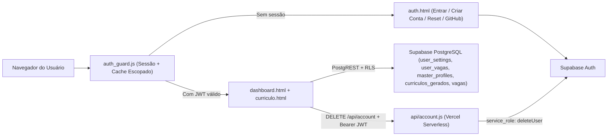

# Sona — Autenticação & Gerenciamento de Contas via Supabase (Design Spec)

**Data:** 2026-11-23  
**Status:** Aprovado no Brainstorming — Aguardando revisão final da especificação  
**Issue Relacionada (Futuro):** [#7 — Sincronização multi-dispositivo criptografada (AES-256-GCM) para chaves de IA (BYOK)](https://github.com/joaofr-tech/estagio-bot-ai/issues/7)

---

## 1. Objetivo & Escopo

Transformar o Sona de uma aplicação *single-user* baseada em `localStorage` em uma plataforma multiusuário fechada (**Login obrigatório**) sobre **Supabase Auth + PostgreSQL com Row Level Security (RLS)**, garantindo que cada pessoa autenticada tenha suas próprias informações isoladas e sincronizadas entre dispositivos.

### Requisitos Fechados
1. **Acesso Fechado (Login Obrigatório):** Usuários não autenticados são redirecionados imediatamente para `/auth.html`; nenhuma tela operacional e nenhum dado do catálogo é acessível sem sessão ativa.
2. **Métodos de Autenticação:** Cadastro e login por **E-mail + Senha** (incluindo fluxo completo de recuperação de senha) e **GitHub OAuth** (com escopo `read:user repo` reaproveitado pelo Sona Resume Studio).
3. **Isolamento Individual Completo (`auth.uid() = user_id`):**
   - Perfil da conta (`display_name`, `handle`, `avatar_url`, `daily_goal`).
   - Progresso e interações por vaga (`status`, `starred`, `mismatch`, etapas, tempos e metadados).
   - Parâmetros e filtros individuais de busca (`crawler_params`: curso/semestre, UF, cidades, turnos, modalidades e áreas).
   - Banco de Fatos (`master_profiles`) e histórico de currículos gerados (`curriculos_gerados`).
4. **Política Zero-Knowledge para Chaves BYOK (Escopo Atual):** `byok_provider` e `byok_model` são salvos em `user_settings`, enquanto a chave secreta `apiKey` permanece exclusivamente no navegador escopada por `user_id` (`sona_byok_key_<uid>`). A sincronização multi-dispositivo cifrada com AES-256-GCM está registrada separadamente na Issue #7.
5. **Gerenciamento de Conta Completo:** Edição de perfil e meta diária, troca de senha, exportação de dados em JSON, migração assistida de dados locais legados, encerramento de sessão multi-aba e exclusão definitiva de conta (`ON DELETE CASCADE`).

### Fora de Escopo
- Criptografia e armazenamento de chaves BYOK no banco (Issue #7).
- Execução de pipelines ETL individuais por usuário no GitHub Actions: `public.vagas` permanece um catálogo global alimentado pelo ETL via `service_role`, enquanto filtros, status e candidaturas são 100% individuais por usuário.

---

## 2. Arquitetura & Componentes



### Novos Arquivos
| Arquivo | Responsabilidade |
| :--- | :--- |
| `schema_auth_supabase.sql` | Script SQL idempotente criando `user_settings`, `user_vagas`, trigger `on_auth_user_created`, índices e políticas RLS (incluindo restrição `to authenticated` em `vagas` e `historico_execucoes`). |
| `auth_guard.js` | Singleton `window.SonaAuth`: cliente Supabase único, guard anti-FOUC, listener `onAuthStateChange` multi-aba e `<iframe>`, validação anti-*open-redirect*, chaves `localStorage` escopadas por `user_id` e mapeamento `store <-> user_vagas`. |
| `auth.html` | Página dedicada de entrada (`Entrar`, `Criar Conta`, `Recuperar Senha`, `Definir Nova Senha` e `Continuar com GitHub`) aderente ao `DESIGN.md`. |
| `auth.css` | Estilos específicos da superfície centralizada de autenticação reutilizando os tokens de `design-system.css`. |
| `api/account.js` | Endpoint serverless `DELETE /api/account` para exclusão definitiva da própria conta autenticada via `SUPABASE_SERVICE_ROLE_KEY`. |
| `tests/auth_and_account.test.js` | Suíte automatizada de testes cobrindo serialização, isolamento por `user_id`, migração legada, validação anti-*open-redirect*, `/api/account` e conformidade de build/`DESIGN.md`. |

### Arquivos Modificados
| Arquivo | Alteração |
| :--- | :--- |
| `dashboard.html` & `index.html` | Inclusão do `auth_guard.js`, hidratação inicial paralela (`user_settings` + `user_vagas` + `vagas`), `upsert`/remoção pontual por vaga, persistência de `crawler_params` e `daily_goal`, card dinâmico do usuário na sidebar e construção da Tela 07 (`Configurações`). `index.html` é mantido idêntico ao `dashboard.html` pelo script de build. |
| `curriculo.html` & `curriculo.js` | Uso do `window.SonaAuth`, remoção do modo anônimo `"Armazenamento local"`, escopo de cache local por `user_id` e sincronização de `byok_provider` e `byok_model` em `user_settings`. |
| `scripts/build_dashboard.js` | Sincroniza `dashboard.html -> index.html` e copia `auth.html`, `auth.css` e `auth_guard.js` para `public/`. |
| `servidor.js` | Habilita método `DELETE` no CORS/roteador `/api/*` e inclui `docs` em `BLOCKED_DIRS`. |
| `vercel.json` & `.vercelignore` | Configura `api/account.js` (`maxDuration: 15`) e ignora `docs/` no empacotamento estático. |
| `tests_py/test_e2e_studio.py` | Adiciona teste E2E do bloqueio não autenticado (`-> /auth.html`) e injeta sessão mockada nos cenários E2E do painel e do Resume Studio. |
| `README.md` | Documenta a execução de `schema_auth_supabase.sql` e a configuração de Auth Redirect URLs no Supabase. |

---

## 3. Modelo de Dados & Segurança RLS (`schema_auth_supabase.sql`)

### 3.1 Tabela `public.user_settings`
Armazena preferências da conta, meta operacional e parâmetros de busca (1 registro por usuário):

```sql
create table if not exists public.user_settings (
  user_id uuid primary key references auth.users(id) on delete cascade,
  display_name text not null default '',
  handle text not null default '',
  avatar_url text not null default '',
  daily_goal integer not null default 5 check (daily_goal between 1 and 50),
  crawler_params jsonb not null default '{}'::jsonb,
  byok_provider text not null default 'gemini',
  byok_model text not null default 'gemini-2.5-flash',
  created_at timestamp with time zone default timezone('utc'::text, now()) not null,
  updated_at timestamp with time zone default timezone('utc'::text, now()) not null
);
```

- **Trigger `on_auth_user_created` (`public.handle_new_user()`):** função `SECURITY DEFINER` (`set search_path = public`) disparada em `AFTER INSERT ON auth.users`. Extrai `display_name` (`full_name` / `name` / parte local do e-mail), `handle` (`@` + `user_name` ou prefixo sanitizado do e-mail) e `avatar_url` de `new.raw_user_meta_data`, executando `INSERT INTO public.user_settings ... ON CONFLICT (user_id) DO NOTHING`.
- **Fallback Defensivo no Cliente:** caso uma conta pré-existente no projeto Supabase ainda não possua linha em `user_settings`, o primeiro carregamento autenticado no cliente executa `upsert` inicial idempotente.

### 3.2 Tabela `public.user_vagas`
Armazena o estado individual de cada usuário sobre cada vaga interagida:

```sql
create table if not exists public.user_vagas (
  user_id uuid not null references auth.users(id) on delete cascade,
  vaga_key text not null,
  vaga_id text,
  status text not null default 'para_aplicar',
  starred boolean not null default false,
  etapa_concluida boolean not null default false,
  candidatura_externa boolean not null default false,
  data_aplicacao text,
  inicio_candidatura bigint,
  tempo_gasto_segundos integer,
  motivo_mismatch text not null default '',
  detalhe_mismatch text not null default '',
  data_mismatch text,
  metadata jsonb not null default '{}'::jsonb,
  updated_at timestamp with time zone default timezone('utc'::text, now()) not null,
  primary key (user_id, vaga_key)
);

create index if not exists idx_user_vagas_user_status
  on public.user_vagas (user_id, status);
```

- O campo `metadata` preserva integralmente `detalhesAcao`, `dataConclusaoEtapa`, `ultimoAssuntoConcluido`, `ultimaDataRecebimentoConcluida` e `motivoEncerramento`.
- **Higiene de Armazenamento:** quando o usuário reverte uma vaga para o estado neutro (`status === 'para_aplicar'`, `starred === false`, sem mismatch e sem etapa concluída), o cliente executa `DELETE FROM public.user_vagas WHERE user_id = uid AND vaga_key = key` em vez de manter linhas vazias.

### 3.3 Políticas RLS
- `public.user_settings` e `public.user_vagas`: RLS ativo com políticas separadas de `SELECT`, `INSERT`, `UPDATE` e `DELETE` exigindo `auth.uid() = user_id` (em `USING` e `WITH CHECK`).
- `public.vagas` e `public.historico_execucoes`: as políticas públicas antigas (`using (true)` para `anon`) são substituídas por políticas exclusivas para `to authenticated using (true)`. O pipeline ETL em Python (`SUPABASE_SERVICE_ROLE_KEY`) continua escrevendo sem alteração.

---

## 4. Fluxo de Autenticação & Regras de UI (`DESIGN.md`)

Toda a interface de autenticação e conta obedece às regras estritas de `DESIGN.md`:
- **Zero emojis** em textos, botões, alertas, estados vazios e toasts (apenas ícones SVG monocromáticos `stroke="currentColor"`).
- **Zero card dentro de card:** `auth.html` renderiza um único painel `#17171B` sobre o canvas `#111114`; a Tela 07 organiza cada grupo em seções planas separadas por bordas `rgba(255,255,255,0.07)`.
- **Title Case em Português** em botões, abas e títulos (`Entrar na Conta`, `Criar Conta`, `Continuar com GitHub`, `Enviar Link de Recuperação`, `Salvar Nova Senha`, `Salvar Alterações`, `Alterar Senha`, `Exportar Meus Dados`, `Sair da Conta`, `Excluir Conta`).

### Modos de `auth.html`
1. **`Entrar` (padrão):** campos `E-mail` e `Senha`, ação primária `Entrar na Conta`, ação secundária `Continuar com GitHub` (`scopes: 'read:user repo'`) e link `Esqueci Minha Senha`.
2. **`Criar Conta`:** campos `Nome de Exibição`, `E-mail` e `Senha` (mínimo 8 caracteres). Se `signUp` retornar `session` ativa, redireciona direto ao painel; se `session === null` (confirmação de e-mail habilitada no projeto Supabase), exibe mensagem clara instruindo a abertura do link enviado ao e-mail.
3. **`Recuperar Senha`:** campo `E-mail` disparando `resetPasswordForEmail(email, { redirectTo: origin + '/auth.html?mode=reset' })`.
4. **`Definir Nova Senha`:** ativado por `?mode=reset` ou pelo evento `PASSWORD_RECOVERY` do Supabase Auth; solicita `Nova Senha` e `Confirmar Nova Senha` e aplica `supabase.auth.updateUser({ password })`.

### Guard de Rota (`auth_guard.js`)
- `dashboard.html` e `curriculo.html` iniciam com `html.auth-pending body { opacity: 0; pointer-events: none; }` em fundo `#111114` para impedir qualquer flash do painel deslogado.
- `SonaAuth.requireSession()` verifica `supabase.auth.getSession()`:
  - **Sessão ausente:** sanitiza o caminho atual (`sanitizeNextPath`, aceitando apenas caminhos relativos iniciados por `/` único, bloqueando `//` ou URLs absolutas) e redireciona `window.top.location.replace('/auth.html?next=...')`.
  - **Sessão válida:** remove `auth-pending`, disponibiliza `SonaAuth.user` / `SonaAuth.session` e registra `onAuthStateChange`. Ao receber `SIGNED_OUT`, limpa referências em memória e redireciona todas as abas abertas para `/auth.html`.

---

## 5. Sincronização, Isolamento Local & Migração Legada

### 5.1 Chaves Locais Escopadas por `user_id`
Para impedir vazamento visual ou contaminação de dados quando duas contas acessam o Sona no mesmo navegador, todas as chaves locais passam a incluir `<uid>`:
- `sona_user_store_<uid>` (cache otimista de `user_vagas`)
- `sona_params_<uid>` (cache otimista de `user_settings.crawler_params` + `daily_goal`)
- `sona_profile_<uid>` (cache de `master_profiles`)
- `sona_history_<uid>` (cache de `curriculos_gerados`)
- `sona_byok_key_<uid>` (objeto `{ apiKey }` restrito ao navegador)

### 5.2 Fluxo de Leitura e Escrita Otimista
1. **Boot Autenticado no Painel:** carrega instantaneamente o cache `sona_user_store_<uid>` / `sona_params_<uid>` (se existir) e dispara em paralelo `Promise.all([loadVagas(), loadHistorico(), loadUserSettings(), loadUserVagas()])`, reconciliando o estado com a nuvem e re-renderizando a tela ativa.
2. **Mutação de Vaga:** uma nova função `persistVagaState(vagaKey)` substitui gravações monolíticas: atualiza `sona_user_store_<uid>` sincronamente (zero latência na UI) e envia `upsert` (ou `delete` se voltou ao estado neutro) apenas daquela `vaga_key` para `public.user_vagas`.
3. **Fila Simples de Re-tentativa:** se o `upsert` falhar por queda momentânea de rede, a `vaga_key` é marcada em `sona_pending_sync_<uid>` e reenviada automaticamente no evento `online` ou no próximo boot autenticado, exibindo toast discreto sem bloquear o uso.

### 5.3 Migração Assistida de Dados Legados
Caso existam chaves antigas pré-autenticação no navegador (`estagios_user_store`, `estagios_crawler_params`, `sona_master_profile_v1`, `sona_resume_history_v1` ou `sona_byok_config_v1`):
- A Tela 07 (`Configurações`) exibe uma seção contextual `Dados Locais Encontrados Neste Navegador` com o botão `Importar Dados para Minha Conta`.
- Ao acionar, faz `upsert`/inserção em lote para `user_vagas`, `user_settings`, `master_profiles` e `curriculos_gerados` (e copia `apiKey` para `sona_byok_key_<uid>` se ainda vazia), removendo as chaves globais legadas somente após confirmação de sucesso da nuvem.

---

## 6. Gerenciamento de Conta (Tela 07 & `/api/account`)

### 6.1 Sidebar & Tela 07 (`Configurações`)
- **Card na Sidebar (`dashboard.html`):** renderiza dinamicamente iniciais (ou `avatar_url` quando disponível), `display_name` e `handle`, mais botão `Sair da Conta` conectado a `SonaAuth.signOut()` (sem `confirm()`/`alert()` nativos bloqueantes).
- **Tela 07 (`#screen-view-07`):**
  1. **Perfil e Operação:** inputs `Nome de Exibição`, `Identificador (@handle)` e `Meta Diária de Candidaturas` (`1`–`50`) + botão `Salvar Alterações` (atualiza `public.user_settings` e `supabase.auth.updateUser({ data: { full_name } })`).
  2. **Segurança e Sessão:** exibe e-mail autenticado e método conectado (`E-mail e Senha` ou `GitHub OAuth`), formulário `Alterar Senha` (`Nova Senha` + `Confirmar Senha`, mínimo 8 caracteres) e botão `Sair da Conta`.
  3. **Portabilidade e Exclusão de Conta:**
     - `Exportar Meus Dados`: gera download de `sona-dados-<handle>-<data>.json` contendo `user_settings`, `user_vagas`, `master_profile` e `curriculos_gerados` (sem incluir `apiKey`).
     - `Importar Dados para Minha Conta`: exibido apenas quando chaves legadas existem no navegador.
     - `Excluir Conta`: solicita digitação exata de `EXCLUIR` em campo de confirmação e chama `DELETE /api/account`. Após `200 OK`, limpa todos os caches `sona_*_<uid>`, executa `signOut({ scope: 'local' })` e redireciona para `/auth.html?deleted=1`.

### 6.2 Contrato de `api/account.js` (`DELETE /api/account`)
- **Autenticação:** exige header `Authorization: Bearer <access_token>` e confirmação explícita `EXCLUIR` (aceita via corpo JSON `{ "confirmation": "EXCLUIR" }` ou header `X-Confirm-Delete: EXCLUIR` para compatibilidade com proxies que descartam body em `DELETE`).
- **Validação & Execução:**
  1. Inicializa cliente admin com `SUPABASE_URL` e `SUPABASE_SERVICE_ROLE_KEY` (retorna `503` claro se variáveis de servidor não estiverem configuradas).
  2. Valida o token com `supabaseAdmin.auth.getUser(token)` (`401` se ausente ou inválido).
  3. Verifica confirmação exata `'EXCLUIR'` (`400` caso contrário).
  4. Executa `supabaseAdmin.auth.admin.deleteUser(user.id)` — o PostgreSQL remove em cascata todas as linhas vinculadas em `user_settings`, `user_vagas`, `master_profiles` e `curriculos_gerados`.
  5. Retorna `200 { "ok": true }`.

---

## 7. Estratégia de Testes & Critérios de Aceite

1. **Testes Automatizados Node.js (`npm test`):**
   - `tests/auth_and_account.test.js`:
     - Conversão bidirecional sem perda entre entradas do `store` do painel e linhas de `public.user_vagas` (incluindo detecção de estado neutro para deleção).
     - Isolamento de chaves `localStorage` entre `user_A` e `user_B` e migração limpa de chaves legadas.
     - Sanitização de redirecionamento `sanitizeNextPath` bloqueando URLs externas, `javascript:` e `//evil.com`.
     - Handler `api/account.js`: `OPTIONS -> 204`, `GET -> 405`, sem Bearer `-> 401`, sem confirmação `EXCLUIR -> 400`, token válido com cliente admin mockado `-> 200` chamando `deleteUser(uid)` exatamente uma vez.
     - Verificação estática de conformidade com `DESIGN.md` (ausência de emojis em `auth.html` e na Tela 07) e paridade de artefatos em `public/` + `index.html == dashboard.html`.
   - `tests/api_and_security.test.js`: garante que `servidor.js` bloqueia `schema_auth_supabase.sql` e `docs/`, permitindo `auth.html`, `auth.css` e `auth_guard.js`.
2. **Testes Python & E2E Playwright (`pytest` + `npm run test:e2e`):**
   - Acesso anônimo a `/dashboard.html` e `/curriculo.html` redireciona automaticamente para `/auth.html`.
   - Alternância entre modos `Entrar`, `Criar Conta` e `Recuperar Senha` em `/auth.html`.
   - Fluxos existentes do Dashboard e do Resume Studio continuam passando integralmente sobre sessão autenticada mockada.
3. **Gate de CI:** `npm run build && npm test && pytest tests_py/test_etl_pipeline.py -v` verdes sem arquivos fora de sincronia em `public/`.
